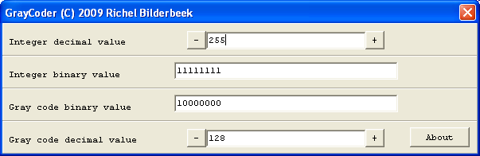

# GrayCoder (VCL)

Convert integer to Gray code and vice versa.

GrayCoder (VCL) is one of [Richèl Bilderbeek's tools](https://richelbilderbeek.github.io/tools/).

## Links

- [Source code](https://github.com/richelbilderbeek/GrayCoderVcl)
- [Richèl Bilderbeek's tools](https://richelbilderbeek.github.io/tools/)
